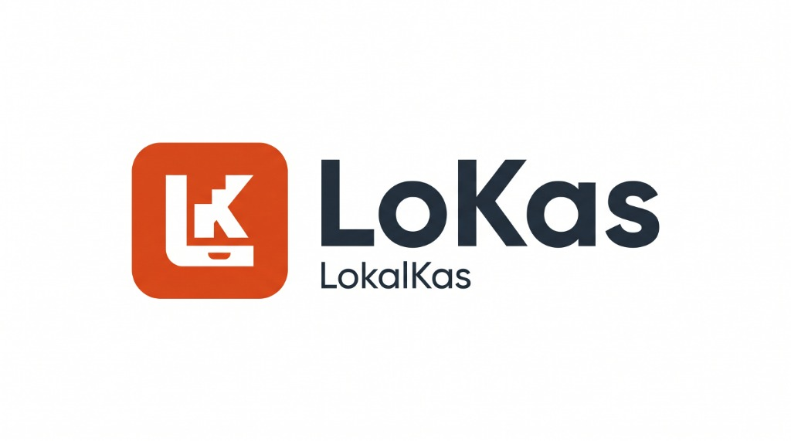
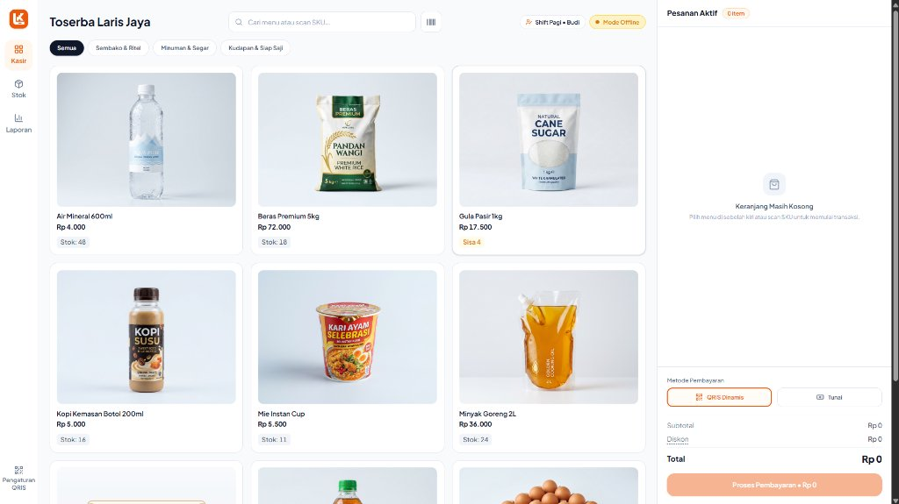
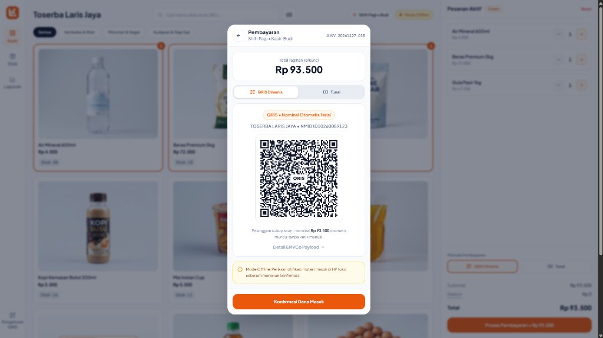
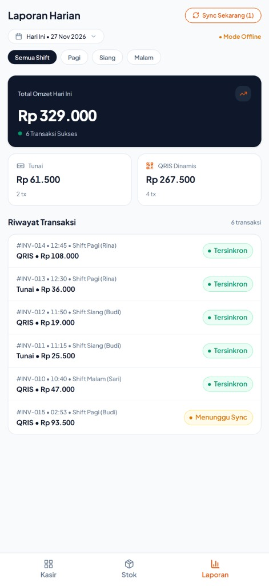
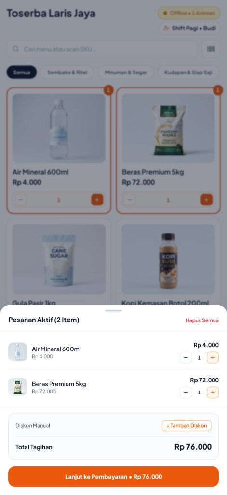
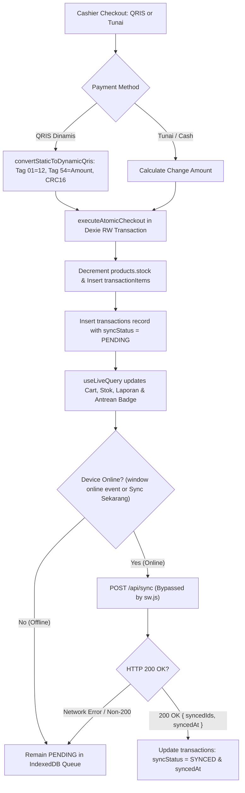

<p align="center">
  
</p>

# LoKas (LokalKas)

**Offline-First MSME Point-of-Sale & Client-Side Dynamic QRIS Engine**

🔗 **Live Demo:** [lokas-two.vercel.app](https://lokas-two.vercel.app/)

Built with **Next.js 15 (App Router)**, **React 19**, **TypeScript**, **Tailwind CSS v4**, **Dexie.js (IndexedDB)**, **Zustand**, **`qrcode.react`**, **`jsQR`**, and a custom **Service Worker**.

> **Indonesian UI Context:** **LoKas** (*short for LokalKas*) is designed for Indonesian MSMEs (*UMKM*) with an Indonesian-language cashier interface—including **Kasir** (Cashier `/`), **Stok** (Inventory & Store/QRIS Setup `/stok`), **Laporan** (Daily Sales Report `/laporan`), **Tunai** (Cash), **Shift Pagi / Siang / Malam** assignment, and sync queue states **Menunggu Sync** (`PENDING`) / **Tersinkron** (`SYNCED`). Out of the box, it seeds a multi-category MSME retail & grocery catalog (*Toserba Laris Jaya*) across *Sembako & Ritel*, *Minuman & Segar*, and *Kudapan & Siap Saji*.

---

## 1. Overview & Problem Statement

Indonesian MSME retail and grocery stores (*toserba* / *warung sembako* such as *Toserba Laris Jaya*), convenience kiosks, and pop-up merchants routinely lose sales or introduce ledger errors due to two coupled operational bottlenecks:

1. **Unstable Connectivity:** Cloud-first POS apps stall or drop orders whenever cellular signal degrades or store Wi-Fi drops, blocking checkout during peak hours.
2. **Static QRIS Payment Friction:** Most MSMEs display a printed static QRIS standee (`Tag 01 = 11`). Customers must manually type the Rupiah total into their banking or e-wallet app—creating checkout queues, input typos, and underpayment disputes.

**LoKas** solves both problems directly in the browser:
- Every catalog read, stock adjustment, and order commit executes atomically against local **IndexedDB** (`LoKasDB`), never blocking on network availability.
- Any merchant's static EMVCo QRIS payload is parsed and converted on-device into a **Dynamic QRIS (`Tag 01 = 12`)** with the exact Rupiah invoice total (`Tag 54`) and a freshly calculated **CRC16-CCITT (`Tag 63`)** checksum—even while completely offline.

---

## Interface Preview

| Desktop Cashier Split View (`/` — Offline & Shift Pill) | Desktop Dynamic QRIS Checkout Modal |
| :---: | :---: |
|  |  |
| **Mobile Daily Sales Report (`/laporan` — Shift Filters)** | **Mobile Cashier & Cart Bottom Sheet (Offline Queue)** |
|  |  |

---

## 2. Key Engineering Highlights

### Local-First Storage & Atomic Transactions (`src/lib/db.ts`, `src/hooks/useNetworkSync.ts`)
- **IndexedDB Schema (`LoKasDB`):** Version `2` defines four indexed object stores via `Dexie`:
  - `merchant` (`id`) — store identity (*Toserba Laris Jaya*), NMID, and active static QRIS string (`'default'`).
  - `products` (`id, sku, category, name`) — multi-category retail & grocery FMCG items, pricing, SKU codes, studio product thumbnails (`imageUrl`), and live stock counts.
  - `transactions` (`id, invoiceNumber, createdAt, paymentMethod, syncStatus, shift`) — immutable order ledger tracking `PENDING` vs. `SYNCED` state alongside active `shift` (`Pagi`/`Siang`/`Malam`) and `cashierName`.
  - `transactionItems` (`id, transactionId, productId`) — line-item snapshots captured at checkout time.
- **Idempotent Boot Seeding:** `seedInitialDataIfEmpty()` uses a shared module-level promise guard (`seedPromise`) so React 19 StrictMode double-invocations never duplicate seed records.
- **Atomic Checkout (`executeAtomicCheckout`):** Executes inside `db.transaction('rw', db.products, db.transactions, db.transactionItems, ...)`:
  1. Verifies each cart item exists and has `product.stock >= line.quantity`.
  2. Decrements `products.stock` for every line item.
  3. Generates a sequential daily invoice number (`#INV-YYYYMMDD-NNN` via `generateNextInvoiceNumber()`).
  4. Inserts the `transactions` record (`syncStatus: 'PENDING'`) and all `transactionItems` rows.
  5. Automatically rolls back the entire IndexedDB transaction if stock is insufficient or cash tendered is below the order total.
- **Reactive Sync Queue (`useNetworkSync`):** Subscribes to `db.transactions.where('syncStatus').equals('PENDING').count()` via `useLiveQuery`. When `navigator.onLine` transitions back to `true` (or the cashier clicks *Sync Sekarang*), `syncNow()` batches pending IDs to `POST /api/sync` and atomically marks acknowledged transactions as `SYNCED` with `syncedAt`.

### Client-Side EMVCo Dynamic QRIS Engine (`src/lib/qris-engine.ts`, `QrisSetupModal.tsx`, `PaymentModal.tsx`)
Instead of relying on an external payment gateway API to generate dynamic QR codes, `qris-engine.ts` implements pure-TypeScript EMVCo Merchant-Presented Mode TLV manipulation:

1. **Sequential TLV Parsing (`parseEmvTlv`):** Reads `Tag (2 chars) + Length (2 digits) + Value (N chars)` sequentially across the payload, throwing on malformed lengths or truncated fields.
2. **Tag Stripping & POI Switch (`convertStaticToDynamicQris`):**
   - Rounds and validates `amountIdr > 0`.
   - Strips any existing `Tag 54` (Transaction Amount) and `Tag 63` (CRC).
   - Switches `Tag 01` (Point of Initiation Method) from `'11'` (Static) to `'12'` (Dynamic), or inserts `010212` immediately after `Tag 00` if absent.
3. **Rupiah Amount Injection (`Tag 54`):** Encodes the integer IDR amount (`54` + 2-digit zero-padded length + integer string) right after `Tag 53` (`360` for IDR), or before `Tag 58` (`ID`).
4. **CRC16-CCITT Checksum Recalculation (`crc16Ccitt`):** Appends `'6304'` and computes **CRC-16/CCITT-FALSE** (`polynomial = 0x1021`, `init = 0xFFFF`, MSB-first, uppercase 4-char hex—matching standard test vector `"123456789"` → `"29B1"`).
5. **Merchant Extraction & Local QR Image Onboarding:**
   - `extractMerchantInfo()` reads `Tag 59` (Merchant Name), `Tag 60` (City), nested subtag `02` across `Tag 51` and `Tags 26–45` (NMID), and validates integrity via `verifyQrisCrc()`.
   - In `QrisSetupModal.tsx`, merchants can upload a photo/screenshot of their existing static QRIS standee; the image is drawn onto an offscreen `<canvas>` (capped at 1024px) via `createImageBitmap` and decoded 100% locally with `jsQR` before saving to IndexedDB. `PaymentModal.tsx` renders the resulting dynamic string with `QRCodeSVG` (`level="H"`).

### Service Worker Caching Strategy (`public/sw.js`)
The Service Worker (`lokas-cache-v3`) separates static/UI resilience from API reachability:
- **`install` & `activate`:** Precaches `/`, `/stok`, `/laporan`, `/manifest.json`, and `/icons/icon.svg`, promotes immediately via `skipWaiting()`, cleans older cache versions, and takes control with `clients.claim()`.
- **API Bypass (`/api/*`):** Requests starting with `/api/` (such as `/api/sync`) are **never intercepted or cached**, ensuring sync calls genuinely fail offline so queued transactions accurately stay `PENDING`.
- **Cache-First Static Assets:** `/_next/static/*`, `/images/*`, `/icons/*`, and `/manifest.json` resolve from cache first and populate dynamically on first fetch for instant offline hydration of bundles and product images.
- **Network-First Navigations:** Page navigations and same-origin GETs try the network, refresh the cache on `200`, and fall back to cached route responses (or cached `/` for navigations) when offline.

---

## 3. Architecture & Sync Flow Diagram



---

## 4. Honest Architectural Trade-offs & Current Limitations

1. **Stateless `/api/sync` Acknowledgment Endpoint:**
   [`src/app/api/sync/route.ts`](src/app/api/sync/route.ts) currently validates incoming `transactionIds` and returns `{ ok: true, syncedIds, syncedAt }` without writing to a server-side database. All durable operational data resides solely in the client browser's IndexedDB (`LoKasDB`). Multi-device synchronization, off-device backup, and cross-terminal inventory locking would require backing `/api/sync` with a persistent database (e.g., PostgreSQL) and idempotency keys.
2. **Manual Settlement Confirmation for Offline Dynamic QRIS:**
   Because Dynamic QRIS payloads are synthesized purely client-side without calling a payment gateway API, there is no real-time settlement webhook while offline. As surfaced in the `PaymentModal.tsx` banner (*"Mode Offline: Periksa notifikasi mutasi masuk di HP toko sebelum menekan konfirmasi"*), the cashier must visually or audibly verify funds arrived on the merchant's banking/QRIS notification device before confirming checkout.
3. **Single-Browser Persistence & No Auth Layer:**
   Clearing browser site storage wipes local IndexedDB tables, and there is no multi-user authentication or conflict-resolution strategy (e.g., CRDTs or server-authoritative stock reconciliation) across concurrent devices.

---

## 5. Local Setup & Offline Verification Guide

### Prerequisites & Running Locally
- **Node.js 20+** and **npm**

```bash
# 1. Install dependencies
npm install

# 2. Optional: Verify EMVCo QRIS engine & TypeScript types
npx tsc --noEmit

# 3. Build production bundle (required for Service Worker offline route caching)
npm run build

# 4. Start production server on http://localhost:3000
npm run start
```

> For rapid UI development without production caching, run `npm run dev`.

### Testing Offline Mode in Chrome DevTools
1. Open `http://localhost:3000` in Chrome after running `npm run build && npm run start`.
2. Open **Chrome DevTools → Application → Service Workers** and verify `/sw.js` is activated and running (`lokas-cache-v3`).
3. Visit **`/`** (Kasir), **`/stok`**, and **`/laporan`** once while online so Next.js route payloads and `/_next/static/*` chunks are cached.
4. Open **DevTools → Network**, change throttling from **No throttling** to **Offline**.
5. Confirm the header status pill switches to **`Offline • ... Antrean`**.
6. Reload the browser (`Ctrl+R`) and navigate between `/`, `/stok`, and `/laporan`—all routes continue loading from `/sw.js` cache.
7. Add items on `/`, open payment (`Proses Pembayaran`), inspect `Detail EMVCo Payload` (`Tag 01: 12`, `Tag 54`, `Tag 63`), and click **`Konfirmasi Dana Masuk`**.
8. Check `/laporan` to verify the new transaction is recorded with **`Menunggu Sync`** (`PENDING`) and `/stok` to confirm stock was atomically decremented.
9. Switch **DevTools → Network** back to **No throttling** (Online). `useNetworkSync` will detect the `online` event, call `POST /api/sync`, and transition queued transactions to **`Tersinkron`** (`SYNCED`).
